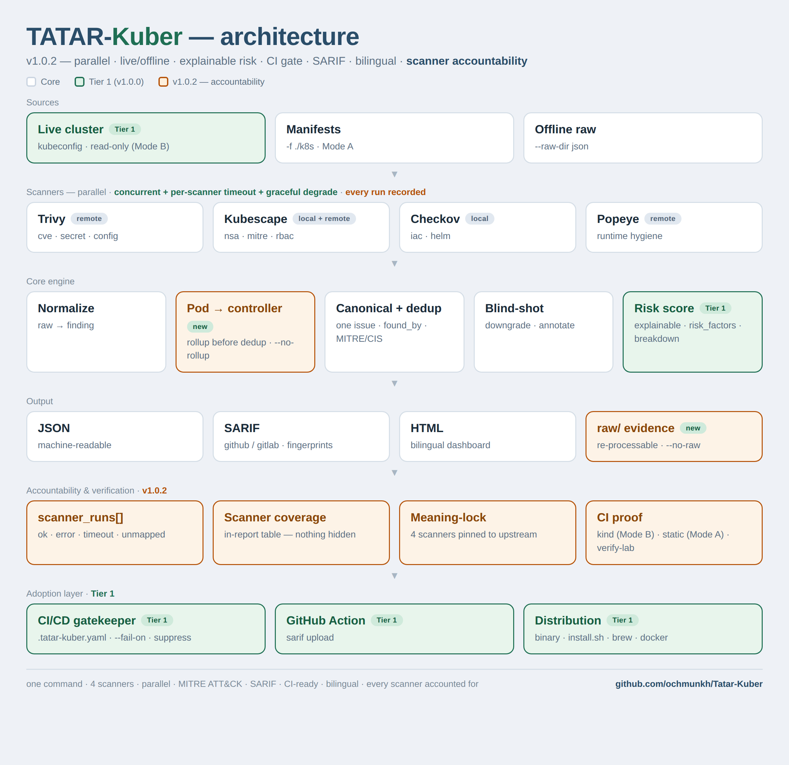
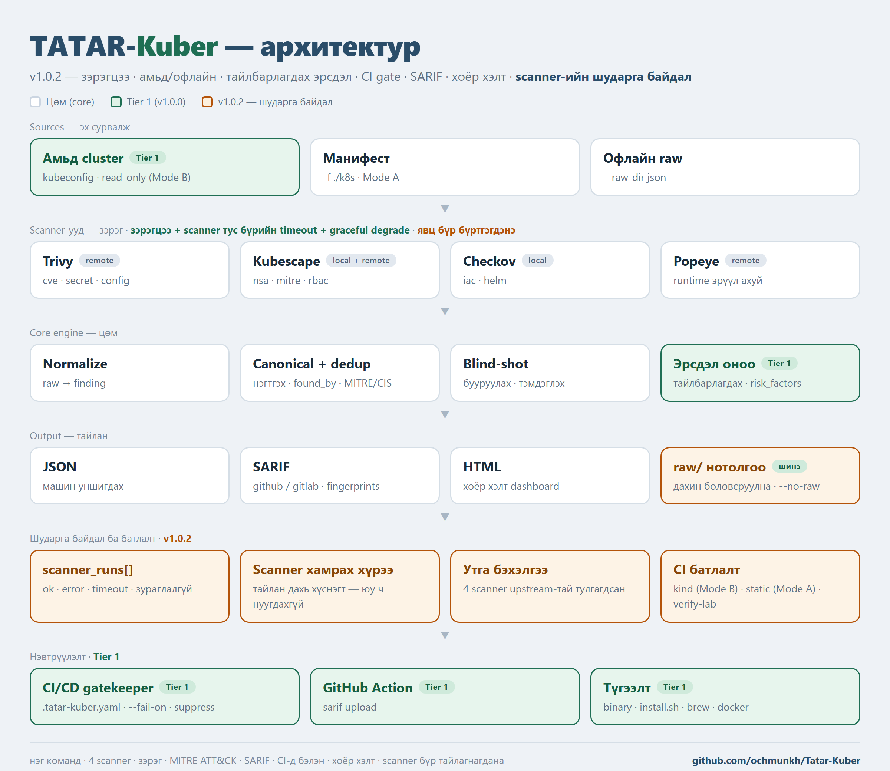

# TATAR-Kuber


[](https://github.com/ochmunkh/Tatar-Kuber/actions/workflows/ci.yml)
[](https://github.com/ochmunkh/Tatar-Kuber/actions/workflows/real-cluster.yml)


**Kubernetes security posture assessment — one command, four scanners, one report.**

TATAR-Kuber is not a scanner. It runs **Trivy · Kubescape · Checkov · Popeye**, maps their
different rule IDs onto one set of **canonical controls**, merges duplicates ("3 scanners found
1 issue", not "3 findings"), scores the risk, and writes a single report — **JSON, SARIF or
HTML, in English or Mongolian** — that engineers, auditors and managers can all read.

```bash
tatar-kuber scan   --kubeconfig ~/.kube/config --out-dir out     # live cluster, read-only
tatar-kuber scan   --raw-dir ./raw --out-dir out                 # or: offline, from saved scanner output
tatar-kuber report --input out/scan-result.json --format html --out report.html
```

## Report — one issue, every scanner, both languages

The same scan rendered in **English** and **Mongolian** (`--lang en|mn`). Note
`found_by = checkov · kubescape · trivy` on the privileged container: one finding, three tools
agreeing, with confidence, evidence and remediation.


See a real report without installing anything: **https://ochmunkh.github.io/Tatar-Kuber/**
([English](https://ochmunkh.github.io/Tatar-Kuber/report.html) ·
[Монгол](https://ochmunkh.github.io/Tatar-Kuber/report-mn.html) ·
[SARIF](https://ochmunkh.github.io/Tatar-Kuber/tatar-kuber.sarif)), or open the files in
[`examples/report/`](examples/report).

## How it works



```
sources → scanners (parallel) → normalize → canonical + dedup → blind-shot → risk score → report → CI gate
```

1. **Collect.** From a live cluster (read-only), local manifests (`-f`), or saved scanner output (`--raw-dir`).
   The four scanners run in parallel, each with its own timeout; if one fails the others still finish.
2. **Normalize.** Every scanner's rule IDs become stable `TATAR-*` controls.
3. **De-duplicate.** The same issue seen by several scanners becomes one finding with `found_by` and a confidence level.
   Example: Trivy `AVD-KSV0017`, Kubescape `C-0057` and Checkov `CKV_K8S_16` are all the same privileged
   container → one `TATAR-CON-001` on `deployment/api`, confidence HIGH. See [`docs/dedup-example.md`](docs/dedup-example.md).
4. **Score.** Risk is explainable: every finding carries its factors, and the cluster score shows its formula and top contributors.
   Findings that are only reachable in unusual contexts are down-graded, never hidden.
5. **Report and gate.** JSON, SARIF 2.1.0 and a bilingual HTML dashboard; a `gate` command fails a pipeline when a policy is broken.

Design rules: **read-only first** (`get`/`list`/`watch` only), **scanner agnostic** (adapters are pluggable),
**honest about gaps** (a control no scanner checks is listed as *not checked*, never counted as passed).

## Install

```bash
# Homebrew (macOS / Linux)
brew install ochmunkh/tap/tatar-kuber

# Linux / macOS — downloads the release binary and verifies its checksum
curl -fsSL https://raw.githubusercontent.com/ochmunkh/Tatar-Kuber/master/install.sh | sh

# Docker
docker run --rm -v "$PWD:/work" -w /work ghcr.io/ochmunkh/tatar-kuber:latest \
    scan --raw-dir ./raw --out-dir .

# From source
go install github.com/ochmunkh/tatar-kuber/cmd/tatar-kuber@latest
```

For live scanning the four scanners must be installed. `tatar-kuber doctor` shows which are, and
`tatar-kuber update` installs the pinned versions after verifying each checksum.

## Quick start (offline, no cluster, no scanner install)

This repository ships real scanner output in [`examples/demo`](examples/demo), so the whole
pipeline runs in about 30 seconds:

```bash
git clone https://github.com/ochmunkh/Tatar-Kuber && cd Tatar-Kuber
tatar-kuber scan   --raw-dir examples/demo --out-dir out
tatar-kuber report --input out/scan-result.json --format html --out report.html
tatar-kuber report --input out/scan-result.json --format html --lang mn --out report-mn.html
```

`--lang` re-renders the report, so switching language never re-runs the scanners or touches the
cluster. The CLI itself speaks English by default; `--lang mn` or `TATAR_LANG=mn` switches it to Mongolian.
A larger regression corpus (vulnerable and hardened manifests) lives in
[**tatar-kuber-lab**](https://github.com/ochmunkh/tatar-kuber-lab).

## Scanners

| Scanner | Purpose | Live-tested with |
|---|---|---|
| Trivy | Image CVEs, secrets, misconfiguration | 0.76 |
| Kubescape | NSA / MITRE / RBAC / compliance (primary posture engine) | 4.0 |
| Checkov | IaC (YAML / Helm / Terraform) | 3.4 |
| Popeye | Runtime hygiene (dead service, unused, broken reference) | 0.22 |

The versions are the ones pinned in [`tools.lock.yaml`](tools.lock.yaml) and exercised daily by the
[real-cluster workflow](.github/workflows/real-cluster.yml). A scanner that renames a flag shows up as
`error` / `unavailable` in the report's *Scanner coverage* table, not as a silent zero.

## Commands

| Command | What it does |
|---|---|
| `scan` | Run the scanners (or read `--raw-dir`) and write `scan-result.json`; live scans also keep the raw scanner output as evidence |
| `report` | Render a result as `json`, `sarif`, `html`, `audit` or `pdf` (`--format`, `--lang`) |
| `gate` | Fail (exit 1) when the result breaks the policy in `.tatar-kuber.yaml` (`--fail-on`, `--baseline`) |
| `diff` | What is new, fixed or worse between two scans |
| `top` | What to fix first: the worst workloads and the controls that hit the most resources |
| `attest` | A person's signed answer, with an expiry, for controls no scanner checks |
| `doctor`, `update` | Which scanners are installed; install the pinned versions |

Every command takes `--lang en|mn`. Exit codes: `0` ok, `1` policy violated, `2` runtime error,
`3` usage error. Full flags, exit codes and the read-only RBAC for live scans:
[`docs/cli.md`](docs/cli.md).

## CI/CD gate

Add a `.tatar-kuber.yaml` ([example](.tatar-kuber.yaml.example)) and gate the pipeline, or use the GitHub Action:

```yaml
- uses: ochmunkh/Tatar-Kuber@v1
  with:
    raw-dir: ./raw      # or path: ./k8s
    fail-on: high
```

The first scan of a real cluster returns a lot, and a gate that fails on all of it on day one gets
switched off. Accept today's findings with a **baseline** (`gate --baseline`) and fail only on new or
worse ones; accept single findings with a reason and an expiry date through `suppress`. How, with
examples: [`docs/gate.md`](docs/gate.md).

## Security

A security tool should hold itself to the standard it enforces. In short:

- **Read-only.** The cluster role grants only `get` / `list` / `watch`, and does not include Secrets.
- **Small supply chain.** One direct dependency (`gopkg.in/yaml.v3`); every GitHub Action and container image is pinned; `govulncheck` and `gosec` run on every push.
- **Scanners are untrusted programs.** The report records which binary ran and its SHA-256; a binary changed after `update` verified it is not run; forge credentials are not passed to scanners; raw output carries a `SHA256SUMS` manifest.
- **The gate checks its input.** A `scan-result.json` that disagrees with itself is refused. This is a consistency check, not a signature.
- **Inputs are bounded and output is owner-only** (mode `0600`).

Details and the network behaviour measured for each scanner: [`docs/security.md`](docs/security.md).
Found a vulnerability? See [`SECURITY.md`](SECURITY.md) — GitHub's **Security → Report a vulnerability** (private disclosure).

## Scope

TATAR-Kuber covers **posture, configuration, IaC, image and RBAC analysis with unified reporting**. It is
**complementary to** runtime detection, admission control and secrets management — run it alongside
Falco/Tetragon, Kyverno/OPA and Vault, not instead of them. Features, what is and is not covered:
[`docs/scope.md`](docs/scope.md). Every control against every scanner, including the one no scanner
checks: [`docs/coverage.md`](docs/coverage.md).

## Build

```bash
go build ./...
go test ./...          # 23 packages, all green
./scripts/build.sh 1.0.6
```

## Documentation

Six engineering documents in `docs/` as **Word (`.docx`) files** (GitHub does not render them in the browser):
[01 Unified Schema](docs/01_Unified-Schema-JSON-v1.docx) ·
[02 Canonical Mapping](docs/02_Canonical-Control-Mapping.docx) ·
[03 Scanner Adapter Interface](docs/03_Scanner-Adapter-Interface.docx) ·
[04 Severity & Risk Scoring](docs/04_Severity-Risk-Scoring-Model.docx) ·
[05 CLI Spec](docs/05_CLI-Specification.docx) ·
[06 Repository Structure](docs/06_Repository-Structure.docx).
Guides in Markdown: [commands](docs/cli.md) · [CI gate](docs/gate.md) · [security model](docs/security.md) ·
[scope](docs/scope.md) · [coverage](docs/coverage.md). The JSON Schema of `scan-result.json` is
[`pkg/schema/tatar-schema-v1.json`](pkg/schema/tatar-schema-v1.json). Release notes: [`docs/releases/`](docs/releases).

## Status

**v1.0.6** — see [`docs/releases/`](docs/releases) for what each release changed and [`ROADMAP.md`](ROADMAP.md)
for what comes next. Every mapped rule of all four scanners is pinned by a test against the scanner's own
definition, so a scanner renaming or renumbering a check fails the build.

## Contributing

Contributions are welcome. Start with [CONTRIBUTING.md](CONTRIBUTING.md) and
[`docs/03_Scanner-Adapter-Interface.docx`](docs/03_Scanner-Adapter-Interface.docx); please keep `go test ./...`
green and read the [Code of Conduct](CODE_OF_CONDUCT.md).

## Contact

**Author:** Enkhbat Oyunbayar — Security Analyst

[](https://www.facebook.com/enkhbat.o/)
[](https://github.com/ochmunkh)

## License

Apache-2.0 — see [LICENSE](LICENSE).

---

## Монгол хэл дээр

**Kubernetes аюулгүй байдлын үнэлгээ — нэг команд, дөрвөн scanner, нэг тайлан.**

TATAR-Kuber өөрөө scanner биш. Энэ нь **Trivy · Kubescape · Checkov · Popeye**-ийг ажиллуулж, тэдний өөр
өөр rule ID-г нэг **canonical control**-ийн багц руу буулгаж, давхардлыг арилгаж ("3 scanner нэг асуудал
олсон" — 3 finding биш), эрсдэлийг үнэлээд нэг тайлан гаргана — **JSON, SARIF эсвэл HTML, англи эсвэл
монгол хэлээр**. Инженер, аудитор, удирдлага бүгд ойлгоно.

```bash
tatar-kuber scan   --kubeconfig ~/.kube/config --out-dir out     # ажиллаж буй cluster, зөвхөн унших
tatar-kuber scan   --raw-dir ./raw --out-dir out                 # эсвэл offline: хадгалсан scanner гаралтаас
tatar-kuber report --input out/scan-result.json --format html --lang mn --out report.html
```

Суулгалгүйгээр жинхэнэ тайлан үзэх: **https://ochmunkh.github.io/Tatar-Kuber/**
([Англи](https://ochmunkh.github.io/Tatar-Kuber/report.html) ·
[Монгол](https://ochmunkh.github.io/Tatar-Kuber/report-mn.html) ·
[SARIF](https://ochmunkh.github.io/Tatar-Kuber/tatar-kuber.sarif)), эсвэл
[`examples/report/`](examples/report)-д байгаа файлуудыг нээ.

### Хэрхэн ажилладаг



```
эх сурвалж → scanner-ууд (зэрэг) → normalize → canonical + dedup → blind-shot → risk score → тайлан → CI gate
```

1. **Цуглуулна.** Ажиллаж буй cluster (зөвхөн унших), локал манифест (`-f`), эсвэл хадгалсан scanner гаралт (`--raw-dir`)-аас.
   Дөрвөн scanner зэрэг ажиллана, тус бүр өөрийн timeout-той; нэг нь унахад бусад нь дуусгана.
2. **Normalize хийнэ.** Scanner бүрийн rule ID тогтвортой `TATAR-*` control болно.
3. **Давхардлыг арилгана.** Хэд хэдэн scanner-ийн олсон ижил асуудал `found_by` болон итгэлийн түвшинтэй нэг finding болно.
   Жишээ: Trivy `AVD-KSV0017`, Kubescape `C-0057`, Checkov `CKV_K8S_16` бүгд нэг privileged контейнер →
   `deployment/api` дээр нэг `TATAR-CON-001`, итгэл HIGH. Харах: [`docs/dedup-example.md`](docs/dedup-example.md).
4. **Оноо өгнө.** Эрсдэл тайлбарлагдахуйц: finding бүр өөрийн хүчин зүйлтэй, cluster-ийн оноо томьёо болон гол
   нөлөөлөгчдөө харуулна. Зөвхөн ер бусын нөхцөлд хүрэх боломжтой finding-ийг бууруулна, хэзээ ч нууж болохгүй.
5. **Тайлан ба gate.** JSON, SARIF 2.1.0, хоёр хэлт HTML dashboard; бодлого зөрчигдвөл `gate` команд pipeline-ийг унагана.

Зарчим: **эхлээд зөвхөн унших** (`get`/`list`/`watch`), **scanner-аас хамаарахгүй** (adapter солигдох боломжтой),
**цоорхойгоо нуухгүй** (ямар ч scanner шалгадаггүй control-ыг "шалгаагүй" гэж харуулна, "тэнцсэн" гэж тоолохгүй).

### Суулгах

```bash
# Homebrew (macOS / Linux)
brew install ochmunkh/tap/tatar-kuber

# Linux / macOS — release binary татаж checksum шалгана
curl -fsSL https://raw.githubusercontent.com/ochmunkh/Tatar-Kuber/master/install.sh | sh

# Docker
docker run --rm -v "$PWD:/work" -w /work ghcr.io/ochmunkh/tatar-kuber:latest scan --raw-dir ./raw --out-dir .

# Эх кодоос
go install github.com/ochmunkh/tatar-kuber/cmd/tatar-kuber@latest
```

Live scan хийхэд дөрвөн scanner суусан байх ёстой. `tatar-kuber doctor` аль нь суусныг харуулна,
`tatar-kuber update` нь пиннэсэн хувилбаруудыг checksum шалгаад суулгана.

### Түргэн эхлэл (offline — cluster ба scanner суулгах шаардлагагүй)

Энэ repo-д жинхэнэ scanner гаралт [`examples/demo`](examples/demo)-д байдаг тул бүтэн pipeline ~30 секундэд ажиллана:

```bash
git clone https://github.com/ochmunkh/Tatar-Kuber && cd Tatar-Kuber
tatar-kuber scan   --raw-dir examples/demo --out-dir out
tatar-kuber report --input out/scan-result.json --format html --out report.html
tatar-kuber report --input out/scan-result.json --format html --lang mn --out report-mn.html
```

`--lang` нь тайланг дахин зурдаг тул хэл сэлгэхэд scanner дахин ажиллахгүй, cluster руу дахин хандахгүй.
CLI өөрөө default-оор англи хэлээр ярина; `--lang mn` эсвэл `TATAR_LANG=mn` нь монгол руу сэлгэнэ.
Том regression corpus (эмзэг ба hardened manifest) нь [**tatar-kuber-lab**](https://github.com/ochmunkh/tatar-kuber-lab)-д байна.

### Scanner-ууд

| Scanner | Зорилго | Бодит орчинд шалгасан |
|---|---|---|
| Trivy | Image CVE, secret, misconfiguration | 0.76 |
| Kubescape | NSA / MITRE / RBAC / compliance (үндсэн posture engine) | 4.0 |
| Checkov | IaC (YAML / Helm / Terraform) | 3.4 |
| Popeye | Runtime hygiene (dead service, unused, broken reference) | 0.22 |

Хувилбарууд нь [`tools.lock.yaml`](tools.lock.yaml)-д пиннэгдсэн, [real-cluster workflow](.github/workflows/real-cluster.yml)
өдөр бүр бодитоор ажиллуулдаг хувилбарууд. Флагаа сольсон scanner нь тайлангийн *Scanner хамрах хүрээ*
хүснэгтэд `error` / `unavailable` гэж харагдана — чимээгүй тэг болохгүй.

### Командууд

| Команд | Юу хийдэг |
|---|---|
| `scan` | Scanner-уудыг ажиллуулж (эсвэл `--raw-dir` уншиж) `scan-result.json` бичнэ; live scan нь scanner-ийн түүхий гаралтыг нотолгоо болгон хадгална |
| `report` | Үр дүнг `json`, `sarif`, `html`, `audit`, `pdf` болгон зурна (`--format`, `--lang`) |
| `gate` | `.tatar-kuber.yaml` бодлогыг зөрчвөл унана (exit 1) (`--fail-on`, `--baseline`) |
| `diff` | Хоёр scan-ийн хооронд юу шинэ, засагдсан, дордсоныг харуулна |
| `top` | Юуг түрүүлж засах: хамгийн муу workload-ууд, хамгийн олон resource-д хүрсэн control-ууд |
| `attest` | Ямар ч scanner шалгадаггүй control-д хүний өгсөн, хугацаатай хариулт |
| `doctor`, `update` | Аль scanner суусныг харуулах; пиннэсэн хувилбаруудыг суулгах |

Команд бүр `--lang en|mn` авна. Exit code: `0` амжилттай, `1` бодлого зөрчигдсөн, `2` ажиллалтын алдаа,
`3` хэрэглээний алдаа. Бүрэн флаг, exit code, live scan-д хэрэгтэй read-only RBAC:
[`docs/cli.md`](docs/cli.md).

### CI/CD gate

`.tatar-kuber.yaml` ([жишээ](.tatar-kuber.yaml.example)) нэмж pipeline-ээ gate-лэ, эсвэл GitHub Action ашигла:

```yaml
- uses: ochmunkh/Tatar-Kuber@v1
  with:
    raw-dir: ./raw      # эсвэл path: ./k8s
    fail-on: high
```

Жинхэнэ cluster-ийн анхны scan олон юм буцаадаг, эхний өдрөөс бүгдэд нь унадаг gate нэг долоо хоногийн дотор
унтарна. Өнөөдрийн finding-үүдийг **baseline**-аар (`gate --baseline`) хүлээн зөвшөөрч зөвхөн шинэ эсвэл
дордсон дээр унага; нэг finding-ийг шалтгаан, дуусах огноотойгоор `suppress`-ээр хүлээн зөвшөөр.
Хэрхэн, жишээтэй: [`docs/gate.md`](docs/gate.md).

### Аюулгүй байдал

Аюулгүй байдлын хэрэгсэл өөрөө мөрддөг стандартаа өөртөө хэрэглэх ёстой. Товчоор:

- **Зөвхөн унших.** Cluster role нь зөвхөн `get` / `list` / `watch` олгоно, Secret-ийг агуулахгүй.
- **Жижиг supply chain.** Нэг шууд хамаарал (`gopkg.in/yaml.v3`); GitHub Action, container image бүр пиннэгдсэн; `govulncheck`, `gosec` push бүрд ажиллана.
- **Scanner бол итгэлгүй програм.** Тайлан аль binary ажилласан, түүний SHA-256-г бичдэг; `update` шалгасны дараа өөрчлөгдсөн binary ажиллахгүй; forge credential scanner-т дамжихгүй; түүхий гаралт `SHA256SUMS` manifest-тэй.
- **Gate өөрийн оролтыг шалгана.** Өөртэйгөө зөрсөн `scan-result.json`-оос татгалзана. Энэ бол тууштай байдлын шалгалт, гарын үсэг биш.
- **Оролт хязгаартай, гаралт зөвхөн эзэмшигчид** (эрх `0600`).

Дэлгэрэнгүй ба scanner бүрийн хэмжсэн сүлжээний зан төлөв: [`docs/security.md`](docs/security.md).
Эмзэг байдал олсон уу? [`SECURITY.md`](SECURITY.md) — GitHub-ын **Security → Report a vulnerability** (хаалттай мэдээлэл).

### Хамрах хүрээ

TATAR-Kuber нь **posture, тохиргоо, IaC, image, RBAC-ийн шинжилгээг нэгдсэн тайлантайгаар** хамарна. Runtime
илрүүлэлт, admission control, нууц удирдлагыг **орлохгүй, нөхөж** ажиллана — Falco/Tetragon, Kyverno/OPA, Vault-тай
хамт ажиллуул. Онцлог, юуг хамарч юуг хамаргүйг: [`docs/scope.md`](docs/scope.md). Control бүрийг scanner бүртэй
тулгасан матриц, ямар ч scanner шалгадаггүй нэгийг оролцуулан: [`docs/coverage.md`](docs/coverage.md).

### Build

```bash
go build ./...
go test ./...          # 23 багц, бүгд ногоон
./scripts/build.sh 1.0.6
```

### Баримт бичиг

`docs/` дотор 6 инженерийн баримт **Word (`.docx`)** хэлбэрээр (GitHub тэдгээрийг browser дээр харуулахгүй):
[01 Unified Schema](docs/01_Unified-Schema-JSON-v1.docx) ·
[02 Canonical Mapping](docs/02_Canonical-Control-Mapping.docx) ·
[03 Scanner Adapter Interface](docs/03_Scanner-Adapter-Interface.docx) ·
[04 Severity & Risk Scoring](docs/04_Severity-Risk-Scoring-Model.docx) ·
[05 CLI Spec](docs/05_CLI-Specification.docx) ·
[06 Repository Structure](docs/06_Repository-Structure.docx).
Markdown гарын авлага: [командууд](docs/cli.md) · [CI gate](docs/gate.md) · [аюулгүй байдлын загвар](docs/security.md) ·
[хамрах хүрээ](docs/scope.md) · [coverage](docs/coverage.md). `scan-result.json`-ы JSON Schema нь
[`pkg/schema/tatar-schema-v1.json`](pkg/schema/tatar-schema-v1.json). Хувилбарын тэмдэглэл: [`docs/releases/`](docs/releases).

### Төлөв

**v1.0.6** — хувилбар бүр юуг өөрчилсөн нь [`docs/releases/`](docs/releases)-д, цаашид юу ирэх нь [`ROADMAP.md`](ROADMAP.md)-д.
Дөрвөн scanner-ийн зураглагдсан rule бүр scanner-ийн өөрийн тодорхойлолттой тестээр тулгагдсан тул scanner
шалгалтаа нэрлэж сольсон эсвэл дугаарыг нь өөрчилсөн бол build унана.

### Хувь нэмэр оруулах

Хувь нэмэр оруулахад таатай. [CONTRIBUTING.md](CONTRIBUTING.md) болон
[`docs/03_Scanner-Adapter-Interface.docx`](docs/03_Scanner-Adapter-Interface.docx)-аас эхэл; `go test ./...`-ийг
ногоон байлгаж, [Code of Conduct](CODE_OF_CONDUCT.md)-ийг унш.

### Холбоо барих

**Зохиогч:** Enkhbat Oyunbayar — Security Analyst

[](https://www.facebook.com/enkhbat.o/)
[](https://github.com/ochmunkh)

### Лиценз

Apache-2.0 — [LICENSE](LICENSE)-ийг үз.
